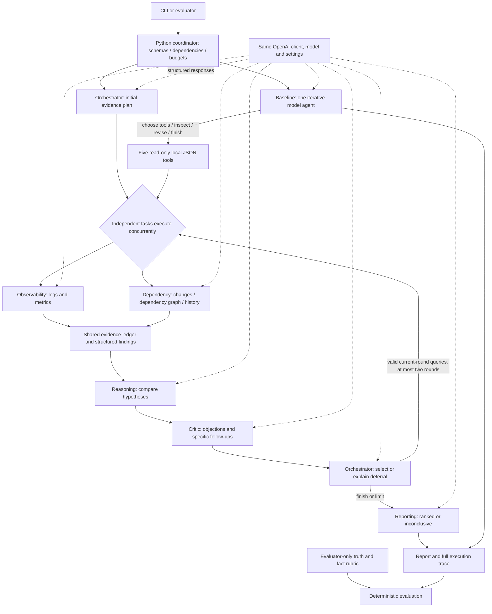

# Incident investigation

A small Python assignment: six model-backed incident-investigation roles, an
iterative single-agent baseline, five read-only simulated tools and ten local
synthetic incidents. No agent framework, database, vector search, investigation
web API, Docker or frontend is required.

**The live paired benchmark is complete: 20 investigations, one per case per
approach. Results are weak, not a demonstration of multi-agent superiority.**
Multi-agent earned 0/9 answerable-case rubric accuracy with seven execution
failures; baseline earned 3/9 with four. Multi-agent appropriately abstained on
the intentionally inconclusive case. All failed and abstained runs are retained.
There were no investigator/prompt/data/rubric changes during evaluation.

The implementation previously passed **289 offline tests** on Python 3.12.
Mocked tests verify mechanics, not LLM reasoning quality. Final clean-setup
verification is recorded separately in `submission\verification.json`.
The short design note is [TECHNICAL-NOTE.md](TECHNICAL-NOTE.md).

## Setup

Requires Python 3.11+ and internet access only to install dependencies or make an
explicitly authorized OpenAI request. Dependencies are Pydantic, OpenAI's SDK,
pytest for tests, and setuptools for editable installation.
The benchmark used Python 3.12.10, OpenAI 2.54.0 and Pydantic 2.14.2; manifests
record exact settings and hashes. Dependency constraints are in `pyproject.toml`,
not a claim that future SDK releases or model aliases are identical.

From the extracted project directory in PowerShell:

```powershell
python -m venv .venv
.\.venv\Scripts\python.exe -m pip install -e ".[dev]"
.\.venv\Scripts\python.exe -m pytest
.\.venv\Scripts\python.exe cli.py list
.\.venv\Scripts\python.exe cli.py collect inc-007
.\.venv\Scripts\python.exe cli.py collect inc-006 --json

# OFFLINE: explicit supplied scripts, not real model reasoning.
.\.venv\Scripts\python.exe cli.py run multi-agent inc-001 --mock-script tests\fixtures\multi_agent.json --output-dir outputs\demo-multi
.\.venv\Scripts\python.exe cli.py run baseline inc-001 --mock-script tests\fixtures\baseline.json --output-dir outputs\demo-baseline
```

On macOS/Linux use `.venv/bin/python` and corresponding path separators.
Keep `data` beside the source files: standalone wheel/data bundling is out of
scope. Always use fresh output directories; saved report/trace files are never
overwritten.

### Credentials and single-incident live commands

Configure `OPENAI_API_KEY` locally through the process/user environment or your
secret manager, then start/restart the terminal as needed. Do not paste keys into
chat, save them in source, or include environment/credential files in a submission.
Missing credentials and invalid CLI inputs produce explicit errors.

**These commands spend API credits and are examples, not authorization to run.**

```powershell
.\.venv\Scripts\python.exe cli.py run multi-agent inc-001 --allow-paid --model gpt-4.1-mini --temperature 0 --output-dir outputs\new-live-multi
.\.venv\Scripts\python.exe cli.py run baseline inc-001 --allow-paid --model gpt-4.1-mini --temperature 0 --output-dir outputs\new-live-baseline
```

All roles and the baseline use the same OpenAI Responses adapter, structured JSON
schema, model and temperature. SDK retries are disabled; `store=False` is used.
The configured alias was `gpt-4.1-mini`, returning `gpt-4.1-mini-2025-04-14`.
Provider documentation now marks this model deprecated. No automatic substitute
is implemented; future availability is not guaranteed.

`run` saves `report.json` and `trace.json`, including prompts, outputs, attempts,
failures, dependencies, evidence and usage. Its exit code is 0 for a ranked report
and 2 for an inconclusive report, including failure fallbacks; setup/parser errors
are nonzero. **Read trace status/termination, not exit code alone, to distinguish
analytical inconclusiveness from execution failure.**

## Layout

| File | Purpose |
| --- | --- |
| `models.py` | Pydantic tool, task, evidence, agent, hypothesis, report and budget contracts |
| `tools.py` | Five simulated tool families, coverage/provenance and deterministic failure injection |
| `agents.py` | Six readable role prompts, strict response schemas and compact payloads |
| `investigation.py` | Shared state, serialized coordinator, permissions, scheduling, budgets and recovery |
| `baseline.py` | One iterative agent using the same coordinator, tools and report schema |
| `llm.py` | OpenAI adapter and clearly identified scripted test double |
| `evaluate.py`, `cli.py` | Evaluation, offline/live entry points and saved artifacts |
| `data`, `tests` | Synthetic sources, private scoring inputs and focused automated regressions |

## Architecture and collaboration



Initial collection and the independent specialist summaries run concurrently.
Workers return values; only the coordinator commits shared state, avoiding
mutation races. Tasks have IDs, prerequisite IDs, statuses, attempt counts and
outputs. Prerequisite-ready waves honor dependencies regardless of input order.

Observability owns logs/metrics; Dependency owns changes/dependencies/history.
Initial-plan schemas constrain those assignments and reuse the same permission
map as runtime checks. Reasoning never receives collection tasks.
The runtime, not the model, controls access, schemas, retries and budgets.

Reasoning compares evidence-backed hypotheses and retains supporting and
contradicting citations. Critic can request discriminating evidence; Orchestrator
must select valid current-round requests or explain omitted ones. New evidence
causes revision, not a predetermined follow-up. Empty current follow-up lists
produce a recorded runtime empty decision rather than an index-generating call.
The baseline repeatedly chooses queries, inspects results and finishes without
separate specialist/Critic roles; its tools execute sequentially.

Affected services are starting points. Downstream queries use leads from acquired
dependency edges, not hidden inventory. Repeated complete/partial reads receive
their existing result/coverage through the same one-correction policy, not silent
reexecution. Distinct windows/filters may overlap; stable IDs deduplicate ledger
records while preserving query provenance.

Hypotheses separate causal stage (`initiating_cause`, `mechanism`, `unknown`),
assumptions, blocking gaps and residual uncertainty. There is no fixed numeric
confidence cutoff. Ranked winners require an initiating-cause label without
blocking gaps, but semantic correctness of those judgments is not guaranteed.
Reporting cannot query tools or change accepted hypotheses. Failed revisions
retain prior analysis; acquired evidence remains available even if analysis fails.
Unresolved critical objections or unavailable critical analysis force an
inconclusive outcome. Recommendations are text only, never production actions.

Compact role-specific prompts carry relevant evidence, provenance, coverage,
current hypotheses/findings and resources. Full task/output history stays in the
trace; essential supporting or contradicting records are not silently truncated.

## Tools, data and hidden ground truth

Five tool families investigate logs, metrics, deployment/configuration history,
service dependencies and historical incidents. Query windows are timezone-aware
and half-open `[start, end)`. Results retain source, original query, collection
time, observed/gap ranges, covered/missing services and matched/returned counts.

| Result | Meaning |
| --- | --- |
| `complete`, records | Requested scope is covered and observations returned |
| `complete`, empty | Covered query genuinely returned no matching observations |
| `partial` | Missing/truncated scope, with explicit issues; may contain useful records |
| `error` | Code/message/retryability and no claimed successful observations |

Coverage means retained observations, not omniscience. Unknown dependency health
is not health; an unqueried source is not confirmed unavailable.

`data\incidents.json` contains neutral IDs and symptom-only alerts. It includes:

| Incidents | Challenge coverage |
| --- | --- |
| `inc-001`, `inc-002`, `inc-010` | Straightforward cases with timing/causal evidence |
| `inc-003` | Misleading deployment |
| `inc-004` | Conflicting observations across scopes |
| `inc-005` | Misleading historical similarity |
| `inc-006` | Incomplete observations |
| `inc-007` | Transient tool failure |
| `inc-008` | Straightforward cause plus misleading historical similarity |
| `inc-009` | Intentionally inconclusive, incomplete data and misleading similarity |

`data\simulation.json` is runtime-only failure/latency configuration. Failure
policy `normalized-query-first-n-attempts-v1` fails the first N attempts of each
distinct normalized query for a configured incident/family; service ordering and
UTC-equivalent timestamps share identity. Fresh tool instances reset counters
per approach, so parallel/sequential call ordering cannot consume each other's
failure injections.

`data\evaluation\ground_truth.json` and `rubric.json` are evaluator-only. Neither
investigator loads them or receives case labels/answers. Isolation is through
loader/tool/prompt separation, not an OS sandbox. Scripted fixture answers are
test inputs only and are never model-performance measurements.

## Shared ceilings and bounded recovery

| Per-investigation ceiling | Both approaches |
| --- | ---: |
| Tool calls, including attempts | 30 |
| Model requests, including corrections | 24 |
| Charged/reserved tokens | 120,000 |
| Maximum output tokens per request | 1,500 |
| Overall wall-clock deadline | 120 seconds |
| Tool / model timeout | 2 / 30 seconds |
| Attempts per operation/query | 3 total |
| Agent-output correction | At most one request per logical operation |
| Critic-driven follow-up rounds | 2 |
| Concurrent tools | 5; baseline deliberately sequential |

Eligible transient transport/tool failures retry within these limits. Selected
safe ownership/order/outcome/duplicate-read errors get one structured correction
with the rejected response, field-specific errors, contract and frozen context.
Every correction is revalidated and counted. Fatal access/reference errors,
refusals, incomplete output and exhausted budgets do not gain broad retries.
Invalid proposals never execute tools or overwrite accepted state.

UTF-8 prompt/schema bytes plus overhead and maximum output conservatively reserve
tokens before dispatch. Actual provider usage replaces reservations, including
rejected responses; unknown usage keeps its reservation and is labeled incomplete.
This is honest runtime preflight, not a provider-side spending guarantee.
Cancellation cannot undo requests already accepted by the provider.

## Evaluation and actual measured results

Offline plumbing tests:

```powershell
.\.venv\Scripts\python.exe -m pytest tests\test_evaluate.py
```

Example commands for a **new, separately approved paid batch**:

```powershell
.\.venv\Scripts\python.exe evaluate.py --mode live --allow-paid --model gpt-4.1-mini --temperature 0 --incidents inc-001 inc-009 --repeats 1 --output-dir outputs\new-live-subset
.\.venv\Scripts\python.exe evaluate.py --mode live --allow-paid --model gpt-4.1-mini --temperature 0 --repeats 1 --output-dir outputs\new-live-evaluation
```

`--budget PATH` accepts a shared `ExecutionBudget` JSON; `--repeats N` supports
repeated evaluation but requires new approval. Existing approval was exhausted
by the saved benchmark: **no further paid run is authorized.**

Evaluation alternates pair order across incidents and gives each approach the
same context, tools, model/settings, schema, failure policy and total ceilings.
Tools reset per run. The manifest records planned order, versions, settings,
data/rubric and implementation hashes. JSON/CSV and per-run report/trace files
retain failures and abstentions; `runs.jsonl` journals completed rows.
The external capture driver used for this approved batch added raw provider
payloads and a systemic authentication/billing circuit breaker. The generic
`evaluate.py` CLI does not itself implement a batch-wide billing stop. The exact
used driver is archived under `provenance` in the submission, not portable as-is.

The deterministic private rubric is deliberately limited:

- Accuracy requires a ranked top category plus required fact-pattern matches on
  nine answerable cases. Terminal failures/abstentions count incorrect.
- Appropriate inconclusiveness requires an insufficiency explanation and no
  terminal failure on `inc-009`. A failure fallback is not appropriate handling.
- Citation existence and actual acquisition are separate from positive/negative
  fact-to-evidence relationships and complete witness sets.
- Tools include retries; latency includes preparation/execution/recovery but not
  artifact writes; provider tokens include all measured responses.
- Null citation scores mean no applicable citations, not perfect grounding.
  Empty failed reports remain in accuracy/failure denominators.

Scores do not verify arbitrary entailment, service attribution, causal stages,
assumptions, confidence calibration or recommendation safety. Fact-pattern
credits can overstate semantic diagnosis quality.

### Frozen live benchmark: all ten and other nine

Exactly twenty live investigations ran on 2026-11-08 with no case repeats.
The other-nine cohort excludes repeatedly used development case `inc-001`; it
is still the same known synthetic dataset, not an external blind holdout.

| Cohort | Approach | Answerable rubric accuracy | Terminal failures | Support links |
| --- | --- | ---: | ---: | ---: |
| All ten | Multi-agent | 0/9 (0%) | 7/10 | 30/55 (54.5%) |
| All ten | Baseline | 3/9 (33.3%) | 4/10 | 9/24 (37.5%) |
| Other nine | Multi-agent | 0/8 (0%) | 6/9 | 30/55 (54.5%) |
| Other nine | Baseline | 3/8 (37.5%) | 4/9 | 7/21 (33.3%) |

Multi-agent's completed runs were inconclusive on `inc-002`, `inc-008`, `inc-009`;
only `inc-009` was appropriate abstention. Its seven other inconclusive reports
were execution-failure outputs. Baseline ranked six reports, with rubric credit
on `inc-002`, `inc-005`, `inc-008`; all four inconclusive outputs were failures,
including `inc-009`. Both approaches recovered the injected `inc-007` tool failure.

Every emitted citation existed and was acquired: 60/60 multi-agent, 24/24 baseline
(other nine: 60/60 and 21/21). One multi-agent and four baseline reports had no
citations. Contradiction-link matches were 2/5 versus n/a. Support scores include
retained hypotheses in failed reports and are not proof of successful analysis.

| Cohort / approach | Tools / model requests | Mean latency | Input / output tokens | Calculated USD |
| --- | ---: | ---: | ---: | ---: |
| All ten / multi-agent | 59 / 94 | 32.50 s | 313,194 / 38,777 | 0.1873208 |
| All ten / baseline | 62 / 44 | 13.35 s | 185,604 / 15,661 | 0.0992992 |
| Other nine / multi-agent | 54 / 88 | 33.83 s | 293,082 / 36,314 | 0.1753352 |
| Other nine / baseline | 60 / 42 | 13.88 s | 180,700 / 14,971 | 0.0962336 |

Total: **498,798 input / 54,438 output tokens; USD 0.2866200**. All 138 provider
responses completed with measured usage and zero cached input. Cost uses
USD 0.40/M input, 0.10/M cached input and 1.60/M output:
`((input-cached)*0.40 + cached*0.10 + output*1.60)/1000000`.
Source: https://developers.openai.com/api/docs/models/gpt-4.1-mini .
Invoice/remaining balance were not independently verified.

No tool/request/token/time budget was exhausted. Three multi-agent completions
hit the two-follow-up-round limit. Twelve correction requests were accounted:
multi-agent rejected all three; baseline accepted five and rejected four.
Each logical operation received at most one correction. No transport retries
or systemic authentication/billing failures occurred.

On this batch baseline was cheaper, faster and more accurate under the rubric.
Multi-agent had higher limited support precision and appropriate abstention,
but also more failures and over-abstention. Early failure lowers consumption:
it is not useful-investigation efficiency. One observation per case does not
establish repeatability or statistical superiority; cross-case variation is
not repeat-run variability.

### Artifacts, sample and remaining limitations

`benchmark-final-result` contains all twenty reports/traces, 138 raw responses,
`results.json`, `results.csv`, `summary.md`, `manifest.json`, `comparison.md` and
`manual-review.md`. Final results live directly in this top-level directory.
Optional cohort, cost, batch-status and redundant review/audit exports were
removed to simplify the folder; the reports, traces and main results remain.
The example commands use separate `outputs` directories for new runs so they do
not mix new observations into the frozen benchmark. Earlier live pairs and the
earlier README snapshot were preserved in the submission package during the
previous cleanup; redundant working copies and mocked outputs were removed.
The earlier live pairs used earlier implementations or only `inc-001`, and must
not be pooled into this benchmark. A successful completion pilot did not predict
reliability. Retained benchmark records were not rewritten during cleanup.

Small excerpt from the actual benchmark baseline report for `inc-008`
(not a fabricated or mocked response):

```json
{
  "incident_id": "inc-008",
  "outcome": "ranked",
  "hypotheses": [{
    "claim": "The payments service errors were initiated by an expired TLS certificate causing handshake failures and preventing secure connections.",
    "confidence": 0.95,
    "cause_category": "tls_validation",
    "causal_stage": "initiating_cause"
  }]
}
```

This is an excerpt, not the full contract. It receives rubric credit but did not
establish the selection/rotation timeline; its recommendation targeted payments
rather than the ledger certificate. Baseline `inc-005` also received credit
without acquiring the resolver configuration change. These are scoring limits,
not reasons to alter the rubric after evaluation.

Live failures included invalid Critic indices into an empty follow-up list,
corrections changing rejected candidates or Critic's role, and Reporting changing
accepted hypotheses. Baseline sometimes mislabeled a mechanism as an initiating
cause at 0.9 confidence; multi-agent overblocked on hypothetical dependencies.
Some limitations remain repetitive or overstate source unavailability.
Recommendations can be overconfident or target the wrong service and require
independent human safety review. No suggested production change was executed.
No code repair or paid rerun was made after observing this benchmark.

## Submission and transcript

The clean submission contains unchanged source/data/tests, this README, the
under-500-word technical note, measured benchmark and prior live artifacts,
verification/provenance and an authentic public-event transcript.
It excludes environments, caches, credentials and unrelated local work.

The actual session event log covers the original foundation request through
benchmark and submission work. There is no available native export RPC in this
assistant environment. Export therefore uses the recorded public events
directly, preserving message/tool content and IDs rather than reconstructing
dialogue from summaries. The JSONL export is authoritative; its reading copy is
mechanically formatted from those events. Provenance records cutoff time,
source-prefix hash, omissions/redactions and output hashes. Non-public runtime
metadata is not included.

**Review the exported transcript and artifacts before sharing.** Automated
credential checks are not a guarantee that all personal/sensitive information
is absent. Redact such information while preserving the substantive conversation.
The snapshot ends at its recorded export cutoff, not future chat activity.
Final ZIP content/integrity and clean offline setup results are recorded in
`submission\manifest.json` and `submission\verification.json`.
