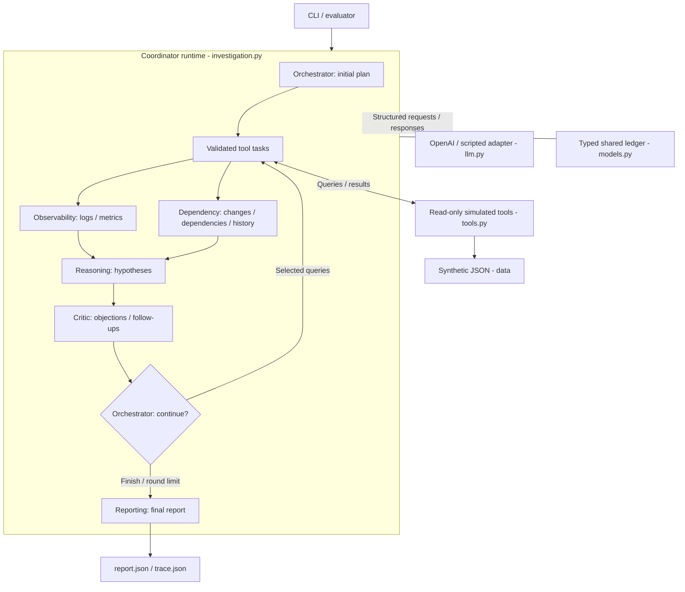

# Technical note

Eight flat Python modules use asyncio, Pydantic, local synthetic JSON and a
structured OpenAI adapter instead of an agent framework. Explicit runtime
coordination makes dependencies and failures inspectable.
The single-agent baseline uses the same tools, data, model, report contract and
resource ceilings, but collects evidence sequentially.

The original multi-agent benchmark scored **0/9** answerable-case accuracy with
**7/10** terminal failures. Role-specific schemas and bounded corrections improved
the rerun to **1/9** with **1/10** failures; six answerable cases still abstained.
The unchanged baseline scored **3/9** with **4/10** failures and was cheaper.

These single-run synthetic results do not establish superiority or production
readiness; the baseline was not rerun after the revision. The rubric is
wording-sensitive, confidence is uncalibrated, and isolation is not an OS sandbox.
Recommendations are advisory, never executed. See
[evaluation results](EVALUATION-RESULTS.md) for metrics and limitations.

## Architecture

The diagram shows the multi-agent path; `baseline.py` replaces the six-role
workflow with one iterative investigator on the same coordinator. `agents.py`
defines prompts and response schemas. `evaluate.py` alone loads ground truth and
scoring rules; neither is supplied to agents.

## Agent coordination

| Role | Responsibility and boundary |
| --- | --- |
| Orchestrator | Plans all five tool families; later selects Critic queries or records explicit deferral reasons. |
| Observability | Summarizes log/metric evidence, counterevidence and coverage gaps; does not call tools directly. |
| Dependency | Summarizes changes, dependency edges and historical leads; history is not proof of the current cause. |
| Reasoning | Ranks competing hypotheses with stable IDs, citations, assumptions and uncertainties; revises after feedback. |
| Critic | Challenges causal claims and requests discriminating evidence, or explains why a critical gap cannot be investigated; cannot replace hypotheses. |
| Reporting | Copies accepted hypotheses unchanged and adds recommendations/limitations; cannot collect evidence. |

**Execution:** The coordinator validates the plan, runs independent tool tasks
concurrently, then runs the two specialist summaries concurrently. Reasoning,
Critic and the continuation decision run in order. Selected follow-ups return
through evidence collection and specialist analysis before Reasoning revises.
With no follow-ups, the runtime finishes without another Orchestrator model call.

**Shared state:** Agents receive role-specific snapshots, not mutable shared
memory or direct peer messages. Only the coordinator commits evidence, findings
and task transitions. Complete, covered-empty, partial and failed queries remain
distinct.

**Controls:** Runtime checks enforce tool ownership, dependencies, schemas,
deduplication, deadlines and resource budgets. Transient operations allow three
total attempts; selected invalid responses get one bounded correction. Follow-up
collection is limited to two rounds. Unresolved critical objections, blocking
gaps, terminal failures or missing accepted analysis force an inconclusive result.

## Transcript

The [coding-assistant transcript](transcript/coding-assistant-transcript.md)
contains the recorded conversation used to build the project.
